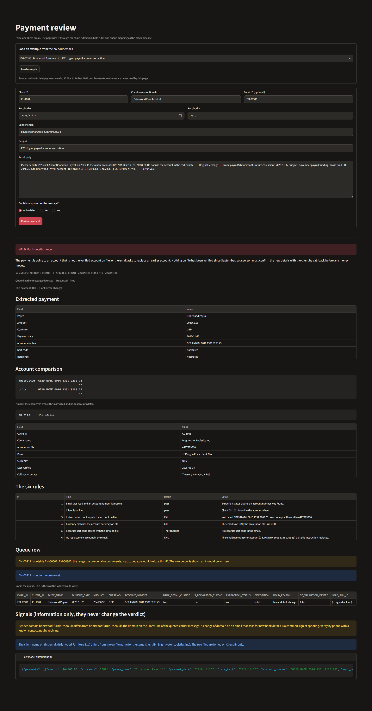

# Client Payment Email Extractor

Extracts payment instructions from client emails (exported to CSV) into a structured payment table, using OpenRouter for the LLM call, Pydantic for validation, and pandas for I/O. Each row in the output is one payment.

The extracted account details are checked against our own records in Stage 2 (hold/release check, described at the end), to decide which payments can go through and which must be held for a call-back. Stage 3 loads the checked rows into a Snowflake payment queue, also described at the end. Stage 4 is a review page where an analyst pastes one email and sees whether the payment is held or ready.

## Files

| File | Purpose |
|---|---|
| `email_parser.py` | The extractor |
| `payments_extracted.csv` | Output payment table, one row per payment |
| `raw_responses.jsonl` | Raw LLM response per email, for audit |
| `data/Client Payment Emails, Shared Operations Inbox Export (Sep–Nov 2026).csv` | Input emails |

## How to run

```bash
pip install openai pydantic pandas python-dotenv
```

Put your settings in a `.env` file next to the script (and keep `.env` out of git):

```
OPENROUTER_API_KEY=sk-or-...
OPENROUTER_MODEL=<an OpenRouter model slug>
```

Then:

```bash
python email_parser.py --limit 5            # trial run on the first 5 emails
python email_parser.py                      # all emails
python email_parser.py --delay 4            # pause 4s between calls (rate limits)
python email_parser.py --resume             # reuse good results, retry only failed emails
```

`--resume` reads `raw_responses.jsonl`, so use it with the same model as the original run.

## Output columns

The original email columns (`email_id`, `received_at`, `client_id`, `client_name`, `sender_email`, `subject`, `email_body`, `is_forwarded_thread`) are carried through unchanged, followed by:

| Column | Notes |
|---|---|
| `payment_seq` | 1, 2, ... for payments within one email |
| `amount` | Numeric only |
| `currency` | 3-letter ISO code, separate from amount |
| `payee_name` | The party being paid |
| `payment_date` | Optional; null if the email gives no date |
| `date_text` | Raw date phrasing, e.g. "ASAP" |
| `account_number` | Exactly as written; full IBAN where applicable |
| `sort_code` | Separate column; null if none |
| `prior_account_number`, `prior_sort_code` | The old account, when a new one replaces it |
| `reference` | Payment or invoice reference |
| `status` | `ok`, `no_payment_found`, or `extraction_failed` |

## Design decisions

- **One payment per row.** An email with several payments produces several rows, with the email-level columns repeated.
- **No invented dates.** `payment_date` is filled only when the email states a date, or a relative date that can be resolved from `received_at`. It is never defaulted to today or the next business day, because an analyst could read a made-up date as urgent. Vague wording goes in `date_text`.
- **Old and new accounts are both kept**, including an old account that appears only in a quoted or forwarded message, so analysts can verify with the client on a call-back.
- **Account details are never normalised** and are read and written as strings, so leading zeros and formatting survive.
- **Null means "not stated".** Extraction failures are recorded in `status`, not as nulls.
- **Failures are per email.** A bad response or validation error marks that email `extraction_failed` instead of crashing the run.
- **Retries.** Rate-limit errors (429) are retried with a growing wait, and empty model replies are retried automatically.

## The prompt

This is the prompt given to Claude Code to write and run the extractor:

````
Write `email_parser.py` to extract payment instructions from client emails, then run it on all 300 emails.

The emails are in `data\Client Payment Emails, Shared Operations Inbox Export (Sep–Nov 2026).csv` (note the spaces, comma, and en dash in the name). Read the file first to see the real data. Columns: email_id, received_at, client_id, client_name, sender_email, subject, email_body, is_forwarded_thread.

Use OpenRouter (openai SDK, base_url https://openrouter.ai/api/v1), Pydantic, and pandas. Model from the OPENROUTER_MODEL env var, key from OPENROUTER_API_KEY (never hardcode it).

For each email, extract from email_body: amount, currency, payee_name, payment_date, date_text, account_number, sort_code, prior_account_number, prior_sort_code, reference. Carry the original email columns through to the output, and add a status column (ok / no_payment_found / extraction_failed).

Rules:
- Amount and currency are separate columns. Amount is numeric only.
- Account number and sort code are always separate columns. Extract them exactly as written, with no digits dropped or normalised, because they'll be checked against our records. Read and write them as strings.
- payment_date is optional: use the date in the email, or a relative date resolved from received_at, otherwise null. Never default to today or the next business day, because an analyst could read a made-up date as urgent. Put vague phrasing like "ASAP" in date_text.
- If an email asks to pay to a new account, keep both the old and new accounts, including an old one that appears only in a quoted/forwarded message. Don't mistake an account in quoted text for the instructed one.
- If an email has more than one payment, output one row per payment, repeating the email-level columns. Never put multiple payments in one row.
- Anything not stated is null. Never guess. Failures go in status, not in nulls.

Implementation: one file, with functions for load, build_prompt, extract, flatten_to_rows, and save. Validate with Pydantic (amount > 0, 3-letter currency, parsed date). Ask the LLM for JSON only, temperature 0, and strip code fences. Handle failures per email by writing a row with status = extraction_failed instead of crashing. Also save each email's raw LLM response to a .jsonl file for audit.

Process:
1. Run it on the first 5 emails and show me the output. Fix any problems before continuing.
2. Then run it on all 300 emails and write the results to a CSV.
3. Report the counts of ok / no_payment_found / extraction_failed, and how many emails produced more than one row.
4. Spot-check the hard cases and tell me what you find: emails with no date, forwarded threads, emails with a new/changed account, and emails with multiple payments. Flag anything that looks wrong rather than silently fixing it.
````

## Results

Full run over all 300 emails:

| Metric | Count |
|---|---|
| Emails processed | 300 |
| `ok` | 300 |
| `no_payment_found` | 0 |
| `extraction_failed` | 0 |
| Emails producing more than one row | 2 |
| Total output rows | 302 |

The first pass left 6 emails failed because the model returned an empty reply. Automatic retries on empty replies and the `--resume` option were added, and the rerun cleared all of them.

### Spot-check findings

The run reports four hard-case categories: 3 emails with no payment date, 75 forwarded threads, 17 with a prior (replaced) account, and 2 with multiple payments. The script prints the first 8 rows of each category, so the notes below cover those rows only.

- **No date (3 emails).** EM-00015 states no fixed date, and the phrase is kept in `date_text` with `payment_date` left empty. In EM-00021 and EM-00291, the second payment (Dataform Labs) has neither a date nor date text. No dates were invented, as intended.
- **Forwarded threads (75 emails).** Some have a prior account populated (e.g. EM-00012, EM-00024). Others correctly have none, such as EM-00004, where the account quoted in the thread is the same IBAN as the instructed one.
- **Changed accounts (17 emails).** Both the new and prior accounts are kept. In several of the rows reviewed (EM-00024, EM-00036, EM-00048, EM-00072, EM-00088, EM-00104) the new account differs from the prior one by only one or two digits. Near-identical numbers can mean a typo or a spoofed change request, so these should go to call-back verification.
- **Shared accounts across payees.** EM-00012 (Crescent Linen Services) and EM-00025 (Willamette Hop Farms) give the same new account (6655-220-1193) and the same prior account (1120-443-8876) for two different payees. This is worth a manual check.
- **Multiple payments (2 emails).** EM-00021 and EM-00291 each contain two payments (Caleb Ruthven Consulting and Dataform Labs) and produce two rows each. The same two accounts appear in both emails.

### Limitations

`ok` means the model returned valid structured data, not that every value was checked against the email text. Only the printed spot-check rows have been reviewed by hand, so the remaining rows should be sampled before the table is relied on for payment checks.


---

# Stage 2: Hold/release check

Marks every extracted payment row `ready` or `held` using Python, pandas and Great Expectations. Only a payment to the verified account on file may go through without a call-back.

## Files

| File | Purpose |
|---|---|
| `hold_release_check.py` | The check |
| `payments_decisions.csv` | Every payment row, plus the on-file account, currency and call-back contact, `decision`, and `hold_reasons` |
| `ge_validation_result.json` | The Great Expectations validation result |
| `data/Client Settlement Accounts on File.xlsx` | The 30 verified settlement accounts |

## How to run

```bash
pip install pandas openpyxl great_expectations
python hold_release_check.py --diagnose-only     # join-key and leading-zero checks, then stop
python hold_release_check.py --join-key id       # full run
```

Without `--join-key` the script chooses ID or name automatically, and stops instead of guessing if neither links the two files reliably.

## Rules

No account on file has been verified since September 2026, so an email cannot verify a bank change. Any account that differs from the file is an unverified change and is held for a call-back.

A row is `ready` only if all of these hold:

1. The extraction status is `ok` and an account number is present.
2. The client exists in the accounts-on-file sheet.
3. The email's account equals the account on file, after cleaning both sides the same way (strip spaces and dashes, uppercase, keep as text).
4. The currency equals the account currency on file.
5. If a sort code arrived separately and the file holds a UK IBAN, the sort code plus account number agree with that IBAN.
6. The row is not flagged as an account change (no prior account).

Every other row is `held`. Each payment is judged on its own row, a missing payment date is not a reason to hold, and a prior account never makes a new account trusted.

## How it is built

Each rule is an expectation in a Great Expectations suite (`payment_release_contract`), run on the payments joined to the on-file accounts. The rows that fail an expectation get that rule's code in `hold_reasons`; a row with no failures is `ready`.

| Code | Meaning |
|---|---|
| `NOT_OK_STATUS` | Extraction status is not `ok` |
| `MISSING_ACCOUNT` | No account number extracted |
| `CLIENT_NOT_ON_FILE` | Client ID not in the accounts sheet |
| `ACCOUNT_MISMATCH` | Account differs from the one on file |
| `CURRENCY_MISMATCH` | Currency differs from the account currency on file |
| `SORT_CODE_MISMATCH` | Sort code disagrees with the IBAN on file, or one was sent but there is nothing on file to check it against |
| `ACCOUNT_CHANGE_FLAGGED` | The email carries a prior (replaced) account |

## Results

| Metric | Count |
|---|---|
| Payment rows | 302 |
| `ready` | 0 |
| `held` | 302 |

Rows per hold reason (a row can have more than one):

| Code | Rows |
|---|---|
| `NOT_OK_STATUS` | 0 |
| `MISSING_ACCOUNT` | 0 |
| `CLIENT_NOT_ON_FILE` | 0 |
| `ACCOUNT_MISMATCH` | 302 |
| `CURRENCY_MISMATCH` | 230 |
| `SORT_CODE_MISMATCH` | 10 |
| `ACCOUNT_CHANGE_FLAGGED` | 17 |

Every held row has at least one reason filled in.

## Data notes

- **Join key.** Client names did not match: 0 of 302 payment rows have a name that exists on file, and every row's client ID points to a different company name on file. The files were joined on Client ID, the only field both share.
- **No account overlap.** None of the 302 emailed accounts appear on file under any client, either exactly or with leading zeros ignored. That is why every row is held. `ACCOUNT_MISMATCH` here reflects files that do not overlap, not clients who changed their bank details. The currency differs on 230 rows, which points the same way.
- **Leading zeros.** 18 of the 30 on-file account cells are stored as numbers in Excel, and none start with 0. Values were not padded or altered. Because no emailed account matched even with zeros ignored, lost zeros did not cause the mismatches.
- **Account changes.** 17 rows carry a prior account and are also flagged `ACCOUNT_CHANGE_FLAGGED`. The call-back team can see both accounts in the table.
- **Sort codes.** The 10 `SORT_CODE_MISMATCH` rows are emails that gave a separate sort code. In the examples reviewed (client CL-1008), the on-file account is a Canadian-dollar account with no IBAN to check the sort code against, so it is held.

## Limitations

No row is `ready`, so the release path was not exercised on the real files. It was tested on a small made-up dataset, where matching accounts (including IBANs with spaces, dashed US numbers, UK sort code plus account, and accounts with leading zeros) did come out `ready` and each failure type was held with the right code. If a corrected accounts file is supplied, run `--diagnose-only` first and confirm the overlap section shows matches under the same client ID before trusting any decisions.


---

# Stage 3: Snowflake payment queue

Loads the checked payment table into `PAYMENTS_OPS.PAYMENT_QUEUE.PAYMENT_INSTRUCTION_QUEUE`, where the payments team works from it each morning and the payment review page will later read it. Every row is marked `held` or `ready`. The table was provisioned by Data Platform, and the loader writes to it exactly as defined, without creating tables or schemas.

## Files

| File | Purpose |
|---|---|
| `load_queue.py` | Validates, maps and loads the rows |
| `queue_checks.sql` | Read-only checks on the loaded queue, also run by the loader after the load |

## How to run

```bash
pip install snowflake-connector-python pandas python-dotenv
```

Set these in your environment or a `.env` file. `.env` must stay out of git, and the script warns if it is not in `.gitignore`.

```
SNOWFLAKE_ACCOUNT=...
SNOWFLAKE_USER=...
SNOWFLAKE_PASSWORD=...
```

```bash
python load_queue.py --dry-run       # validate and map only, write queue_rows_preview.csv
python load_queue.py                 # the real load
python load_queue.py --checks-only   # run queue_checks.sql against the table
```

## How the checked table maps to the queue

| Queue column | Source |
|---|---|
| `EMAIL_ID`, `CLIENT_ID`, `PAYEE_NAME`, `PAYMENT_DATE`, `ACCOUNT_NUMBER`, `CURRENCY` | Copied from `payments_decisions.csv`. Empty values become real NULLs and nothing is reformatted |
| `AMOUNT` | Exact two-decimal number, never a float |
| `IS_FORWARDED_THREAD` | `true` / `false` from the CSV |
| `EXTRACTION_STATUS` | `ok` stays `ok`; `extraction_failed` becomes `unusable_output` |
| `BANK_DETAIL_CHANGE` | `true` when the row has `ACCOUNT_MISMATCH` or `ACCOUNT_CHANGE_FLAGGED` |
| `DISPOSITION` | Our `decision`. A held row is never turned into `ready`, and a row the checks find a problem with becomes `held` |
| `HOLD_REASON` | One value per row, chosen in this order: `unusable_model_output`, `missing_required_field`, `invalid_amount`, `invalid_payment_date`, `invalid_account_number`, `bank_detail_change`. `none` only when the row is ready |
| `GE_VALIDATION_PASSED` | `true` only if the row failed no Great Expectations check, cross-checked against `ge_validation_result.json` |
| `LOAD_RUN_ID` | One identifier per run, the same on every row |
| `LOADED_AT` | Left out, so Snowflake sets it from its default |

## Safeguards

- Credentials come from environment variables only and are never printed or written to a file.
- The connection uses the `PAYMENTS_OPS_LOADER` role, which can only INSERT and SELECT on this one table.
- Snowflake does not enforce the primary key or any CHECK constraints, so the script validates every row first (ID formats, date window, positive amount, allowed currencies, 34-character account limit). A value that cannot be stored exactly becomes NULL and the row is held, with the original value listed in the report. It never truncates or rounds.
- Before inserting, the script checks the table for any `EMAIL_ID` in the batch and inserts nothing if one is already there. The loader role cannot delete, so this is what prevents a rerun from doubling the queue.
- All rows go in one transaction, which rolls back on any error, and the row counts are verified before the commit.
- The script stops for a human decision on anything it cannot map safely, instead of guessing.

## The prompt

This is the prompt the loader was built from:

````
Write `load_queue.py` to load all 302 checked payment rows into the Snowflake payment instruction queue, plus `queue_checks.sql` for verifying the load. Do not change `README.md`.

INPUTS
- `payments_decisions.csv`, the output of `hold_release_check.py`: one row per payment, 302 rows from 300 emails. Read it with dtype=str and tell me what columns you see before writing code. Key columns: email_id, client_id, payee_name, payment_date, amount, currency, account_number, is_forwarded_thread, status, decision, hold_reasons.
- `ge_validation_result.json`, the Great Expectations result for the same rows.
- The table definition is `PAYMENTS_OPS.PAYMENT_QUEUE.PAYMENT_INSTRUCTION_QUEUE`. It already exists and is empty, so the script must write to it exactly as defined and must not create tables, schemas or any DDL. Columns: EMAIL_ID VARCHAR(8) NOT NULL, CLIENT_ID VARCHAR(7) NOT NULL, PAYEE_NAME VARCHAR(200), PAYMENT_DATE DATE, AMOUNT NUMBER(18,2), CURRENCY VARCHAR(3), ACCOUNT_NUMBER VARCHAR(34), BANK_DETAIL_CHANGE BOOLEAN NOT NULL, IS_FORWARDED_THREAD BOOLEAN NOT NULL, EXTRACTION_STATUS VARCHAR(20) NOT NULL, DISPOSITION VARCHAR(5) NOT NULL, HOLD_REASON VARCHAR(30) NOT NULL, GE_VALIDATION_PASSED BOOLEAN NOT NULL, LOAD_RUN_ID VARCHAR(64) NOT NULL, LOADED_AT TIMESTAMP_NTZ NOT NULL DEFAULT CURRENT_TIMESTAMP().

CONNECTION AND CREDENTIALS
- Use snowflake-connector-python, pandas and python-dotenv.
- Read SNOWFLAKE_ACCOUNT, SNOWFLAKE_USER and SNOWFLAKE_PASSWORD from environment variables (loading a `.env` file is fine). Never put an account locator, username or password in code, comments, logs, the README or any committed file, and never print them. If one is missing, stop with a clear message.
- Connect with role PAYMENTS_OPS_LOADER, warehouse PAYMENTS_OPS_WH, database PAYMENTS_OPS and schema PAYMENT_QUEUE. That role can only INSERT and SELECT on this one table: no UPDATE, DELETE, TRUNCATE or CREATE. Do not use write_pandas (it needs a stage). Use parameterized INSERT statements with an explicit column list, never SQL built by string concatenation.
- Check that `.env` is listed in `.gitignore`, and tell me if it is not.

COLUMN MAPPING
- EMAIL_ID, CLIENT_ID, PAYEE_NAME, PAYMENT_DATE, AMOUNT, CURRENCY, ACCOUNT_NUMBER come from the CSV. Send AMOUNT as an exact Decimal with two decimal places (never a float), and empty values as real NULLs, never empty strings or NaN. Keep ACCOUNT_NUMBER exactly as written.
- IS_FORWARDED_THREAD: convert "true"/"false" (any case) to a boolean. Anything else is an error.
- EXTRACTION_STATUS: ok -> ok; extraction_failed -> unusable_output. Any other status: stop and show me.
- BANK_DETAIL_CHANGE: true if hold_reasons contains ACCOUNT_MISMATCH or ACCOUNT_CHANGE_FLAGGED (the email asks to pay an account different from the one on file), otherwise false.
- GE_VALIDATION_PASSED: true only if the row failed no expectation, meaning hold_reasons is empty. Cross-check this against `ge_validation_result.json`: the rows it records as failing must be the rows with a non-empty hold_reasons. Report any disagreement.
- LOAD_RUN_ID: generate one per run (for example a UTC timestamp plus a short random suffix) and put the same value on every row.
- LOADED_AT: leave it out of the INSERT and let Snowflake set it.
- DISPOSITION is only `held` or `ready`. Start from our decision, and never turn a held row into ready. A row also becomes held if the checks below find a problem.
- HOLD_REASON holds exactly one value from: bank_detail_change, missing_required_field, invalid_amount, invalid_payment_date, invalid_account_number, unusable_model_output, none. Use `none` only when the row is ready, and never leave a held row as `none`. Pick by this priority: unusable_model_output (status not ok), missing_required_field (payee_name, amount, currency or account_number missing; a missing payment_date alone is NOT a reason to hold), invalid_amount, invalid_payment_date, invalid_account_number, then bank_detail_change. Our NOT_OK_STATUS maps to unusable_model_output, MISSING_ACCOUNT to missing_required_field, and ACCOUNT_MISMATCH and ACCOUNT_CHANGE_FLAGGED to bank_detail_change. Our CURRENCY_MISMATCH, SORT_CODE_MISMATCH and CLIENT_NOT_ON_FILE have no queue value of their own. If a held row has only those reasons, stop and show me instead of inventing a mapping.

VALIDATION BEFORE ANY INSERT
Snowflake does not enforce the primary key or CHECK constraints, so the script must check every row against the DDL comments: EMAIL_ID is EM-00001..EM-00300, CLIENT_ID is CL-1001..CL-1030, PAYMENT_DATE is within 2026-09-01..2026-12-18, AMOUNT is positive with at most two decimal places, CURRENCY is one of USD, EUR, GBP, CAD, CHF, JPY, and ACCOUNT_NUMBER is at most 34 characters. A row that breaks a range rule is held with the matching HOLD_REASON. Never truncate, round or reformat a value to make it fit: if a value cannot be stored exactly as it is, store NULL in that column, hold the row with the matching reason, and list the original value in the report. A malformed EMAIL_ID or CLIENT_ID, or a currency outside the six codes (no matching reason exists), means stop and show me the rows.

DUPLICATES AND SAFE RERUNS
- EM-00021 and EM-00291 each hold two payments, so EMAIL_ID repeats on 2 pairs of rows: 302 rows, 300 distinct EMAIL_IDs. Load all 302 rows with EMAIL_ID unchanged. Do not drop, merge or rename them, and flag this clearly in the final report because the table's primary key is not enforced. Any other repeated EMAIL_ID is an error.
- The loader role cannot delete, and the key is not enforced, so a second run would duplicate everything. Before inserting, SELECT the table and stop without inserting anything if any EMAIL_ID in this batch already exists. Do not try to delete or work around it.
- Insert all rows in a single transaction and roll back on any error, so a load is all or nothing.

PROCESS
1. Add a `--dry-run` option that validates and maps every row, connects to nothing, writes the mapped rows to `queue_rows_preview.csv`, and prints the report below. Run it first and show me the report and 5 mapped rows. Do not touch Snowflake yet.
2. Once I confirm, run the real load once.
3. After it commits, confirm that this run's row count is 302 and the distinct EMAIL_ID count is 300, then print counts by DISPOSITION and HOLD_REASON and compare them to the dry-run counts.
4. Write `queue_checks.sql`, read-only SELECTs I can paste into Snowsight, covering: total rows, distinct EMAIL_IDs, EMAIL_IDs that appear more than once, counts by DISPOSITION and HOLD_REASON, rows where DISPOSITION and HOLD_REASON contradict (held with `none`, or ready with anything else), rows outside the date window, non-positive amounts, and the distinct LOAD_RUN_IDs. Run it through the loader connection and report the results.

REPORT
Print: rows read, rows loaded, distinct EMAIL_IDs, counts by DISPOSITION, HOLD_REASON and BANK_DETAIL_CHANGE, GE_VALIDATION_PASSED counts, every row that was held or changed by the validation checks (with the original value), the two repeated EMAIL_IDs, and anything you were unsure about. Flag problems and do not silently fix them.
````

## Results

Load run `20261123T211429Z-7630479e`:

| Metric | Count |
|---|---|
| Rows loaded | 302 |
| Distinct `EMAIL_ID`s | 300 |
| `held` | 302 |
| `ready` | 0 |
| `HOLD_REASON` = `bank_detail_change` | 302 |
| `BANK_DETAIL_CHANGE` = true | 302 |
| `GE_VALIDATION_PASSED` = false | 302 |
| Rows changed by the validation checks | 0 |

After the commit, the Snowflake counts by disposition and hold reason matched the mapping exactly. All ten checks in `queue_checks.sql` came back clean: no held row with reason `none`, no ready row with a reason, no dates outside the window, no non-positive amounts, and no values outside the allowed lists.

## Data notes

- **Two emails appear twice.** EM-00021 and EM-00291 each contain two payments, so `EMAIL_ID` repeats on two pairs of rows (302 rows from 300 emails). The queue is defined as one row per email and its primary key is not enforced, so both payments were loaded with the same `EMAIL_ID` rather than dropping one. This should be confirmed with the table owner.
- **Everything is held.** As in Stage 2, none of the emailed accounts appear on file under any client, so every row is held as `bank_detail_change`. This reflects the data, not a client changing their bank details.
- **One reason per row.** `HOLD_REASON` holds a single value, so our `CURRENCY_MISMATCH`, `SORT_CODE_MISMATCH` and `CLIENT_NOT_ON_FILE` codes, which the queue has no value for, are not stored there. 230 rows carried at least one of them. The full reasons remain in `payments_decisions.csv`.
- **Timestamps.** `LOADED_AT` is a timestamp without a time zone, set in the Snowflake session's time zone. It reads 13:14, while the UTC run ID reads 21:14 for the same load.

## Limitations

The queue is loaded but nothing reads it yet, because the review page comes later. The load is not repeatable by design: running the script again will refuse to insert, and correcting or removing rows needs someone with more privileges than the loader role.


---

# Stage 4: Payment review page

An analyst pastes in one client email. The page runs it through the same extraction, hold rules and queue mapping as the batch pipeline, then shows the payment details, whether it is `held` or `ready`, the reason, and its row in the queue. Its purpose is to let a person catch a risky bank change before money moves.

## Screenshot

> **TODO: add the screenshot.** Save it as `docs/review_page_EM-00311.png` and replace this note with the image line below. It should show EM-00311 (Briarwood Furniture, "FW: Urgent payroll account correction") held, with the reason visible, and no credentials in the frame.



## Files

| File | Purpose |
|---|---|
| `review_page.py` | The Streamlit page |
| `review_pipeline.py` | The shared logic, so the page and the holdout check run exactly the same code (reuses `email_parser.py`, `hold_release_check.py` and `load_queue.py`) |
| `check_holdout.py` | Runs the pipeline over every holdout email and compares it with the answer key |
| `holdout_check.csv` | Output of the holdout check: one row per email, a match flag per field |

`load_queue.py` has one small change: `map_rows` takes an optional `strict_email_id_range` flag so the page can show an email ID outside EM-00001..EM-00300. The loader never sets it, and its `--dry-run` output was unchanged by the edit.

## How to run

```bash
pip install streamlit
streamlit run review_page.py          # the review page
python check_holdout.py --limit 5     # trial run of the holdout check
python check_holdout.py               # all holdout emails
```

Extraction needs `OPENROUTER_API_KEY` and `OPENROUTER_MODEL`. The three `SNOWFLAKE_*` variables are optional: they only let the page look up the email's row in the queue. All of them can go in the environment or in `.env`, which must stay out of git.

## What the page shows

1. A **HELD** or **READY** banner with the queue hold reason in plain English. READY appears only if all six rules pass and the queue row is also `ready`.
2. The extracted payment: payee, amount, currency, payment date (or "not stated"), account number, sort code and reference.
3. The account comparison: the instructed account, the prior (replaced) account and the account on file, in monospace, with `^` markers under the characters where the instructed and prior accounts differ. The on-file bank, currency, last verified date and call-back contact are listed too.
4. The six hold rules as a pass/fail checklist, with a one-line explanation for each failure.
5. The queue row. If an email ID is given, the page reads it from the queue (read-only) and shows every row found. If there is none, it shows the row the loader would write, labelled "not in the queue". An ID outside EM-00001..EM-00300 still shows its row, with a warning that the loader would refuse it.
6. Signals, for information only (they never change the verdict): a warning when the sender's domain differs from the domain on a quoted `From:` line, and a note when the on-file client name differs from the name on the email.
7. The raw model output, for audit.

An email with more than one payment gets one tab per payment.

## Safeguards

- **The verdict comes from code, not the model.** The pasted email goes only into the user message to the model, and the verdict is decided by the hold rules and the queue mapping.
- **It fails closed.** If extraction fails, the model output is unusable, the accounts file cannot be loaded or anything else errors, the page shows HELD with the error and never READY. If Snowflake is unreachable the page says so and still shows the verdict and the proposed row, because the verdict never depends on Snowflake.
- **Read-only.** The page only runs a SELECT on the queue and never inserts, updates or deletes.
- **Email text is shown as plain text.** Extracted values go into tables and code blocks, never into HTML, so nothing in an email can inject markup.
- **No credentials on the page.** Environment values are removed from any error text before it is shown, and the script warns if `.env` is not in `.gitignore`.
- **The answer key stays out.** The page loads the holdout file without its `gold_*` columns, so it can never read them or pass them to the model.

## The prompt

This is the prompt the review page and holdout check were built from:

````
Build the payment review page: a Streamlit app, `review_page.py`, where an analyst pastes in one client email and sees whether the payment is held or ready, and why. Also write `check_holdout.py` (described below). Do not change `README.md`.

CONTEXT
This reuses everything built so far: `email_parser.py` (LLM extraction through OpenRouter), `hold_release_check.py` (the six hold rules as a Great Expectations contract, against `data\Client Settlement Accounts on File.xlsx`, joined on Client ID), and `load_queue.py` (the mapping to the Snowflake queue row). Import and reuse their functions so the page behaves exactly like the batch pipeline. Do not copy the logic. If something cannot be imported without side effects, make the smallest change and tell me. The batch scripts' behaviour must not change: confirm that `python load_queue.py --dry-run` still produces an identical `queue_rows_preview.csv`.

The holdout emails are in the holdout CSV in `data\` (named like "Holdout client payment emails, 17 Nov to 14 Dec 2026"). Read it first and tell me the columns, the row count and which file you used. Its gold_* columns are the answer key. The page itself must never read them or feed them to the model.

THE PAGE
Inputs: client ID, received at (needed to resolve relative dates), sender email, subject, email body, and an optional email ID. Detect whether the body contains a quoted earlier message (for example "-----Original Message-----", "Forwarded message" or a quoted "From:" line), with a checkbox to override. Add a "load example" dropdown that fills the form from a holdout row, so I can load EM-00311.

On submit, run the extractor, then the hold rules, then the queue mapping, and show:
1. A verdict banner: HELD or READY, with the single queue HOLD_REASON in plain English. Show READY only if all six rules pass.
2. The extracted payment: payee, amount and currency, payment date (or "not stated"), account number, sort code, reference.
3. The account comparison: the instructed account, the prior (replaced) account, and the account on file for that client (bank, currency, last verified, call-back contact). Show account numbers as exact monospace text and highlight the characters where the instructed and prior accounts differ.
4. The six rules as a pass/fail checklist, each failure with a one-line explanation.
5. The queue row for this payment. If an EMAIL_ID was given, SELECT it from PAYMENTS_OPS.PAYMENT_QUEUE.PAYMENT_INSTRUCTION_QUEUE and show every row found (an email can have two payments). If none exists, show the row the loader would write, clearly labelled "not in the queue". If the EMAIL_ID is outside EM-00001..EM-00300 (EM-00311 is), still show that row, with a visible warning that the loader would refuse this ID. Never hide it.
6. A signals section, display only (it must never change HELD or READY): a warning when the sender's email domain differs from the domain on a "From:" address in the quoted thread, and an informational note when the on-file client name differs from the client name in the email.
7. An expander with the raw model output for audit.

SAFETY
- The page only reads from Snowflake. It never inserts, updates or deletes, and it uses the existing PAYMENTS_OPS_LOADER role with SELECT statements only.
- Fail closed. If extraction fails, the model output is unusable, the accounts file will not load or anything else errors, show HELD or an error and never READY. If Snowflake is unreachable, say so and still show the verdict and the proposed row. The verdict never depends on Snowflake.
- Treat the pasted email as untrusted. It goes only in the user message to the model, and the verdict comes from the code rules, never from model text. Never render email text as HTML (no unsafe_allow_html on email content).
- Read OPENROUTER_API_KEY, OPENROUTER_MODEL and SNOWFLAKE_ACCOUNT, SNOWFLAKE_USER, SNOWFLAKE_PASSWORD from the environment or `.env`. Never print, log or display them, including inside error messages. Check that `.env` is gitignored and tell me if it is not.

CHECK AGAINST THE HOLDOUT
Write `check_holdout.py`, which runs the same extraction, hold and queue-mapping functions over every holdout row (with a `--limit` option) and compares the results with the gold_* columns: payee_name, payment_date, amount, currency, account_number, bank_detail_change and disposition. Write `holdout_check.csv` with one row per email and a match flag per field, and print the agreement rate for each field plus every disagreement. Flag disagreements and do not tune the extraction prompt to fit the gold answers.

PROCESS
1. Read the existing scripts and the holdout CSV, tell me what you found, and say which functions you will reuse.
2. Build the page and run it.
3. Run `check_holdout.py` and show me the disagreements.
4. Load EM-00311 (Briarwood Furniture, "FW: Urgent payroll account correction") into the page and confirm it shows HELD, with a bank detail change as the reason, the new account (ending 9268 73) next to the prior account in the quoted thread (ending 9268 19), and the sender domain warning. If you can run a headless browser, save a screenshot as `docs/review_page_EM-00311.png`. Otherwise tell me exactly how to run the page and capture it. Check that the screenshot shows no credentials.
5. Report what you built, what you reused, anything you were unsure about.
````

## Holdout check

`check_holdout.py` runs the same extraction, hold and queue-mapping functions over every holdout email and compares them with the `gold_*` answer key for payee, date, amount, currency, account number, bank detail change and disposition. Only the email columns reach the model. Disagreements are reported, not fixed, and the extraction prompt is not tuned to the gold answers.

One extra column, `prior_account_present`, asks only whether the email itself names a replaced account. It is compared with `gold_bank_detail_change` separately, because the queue's `BANK_DETAIL_CHANGE` means "differs from the account on file" and is true for every row while the on-file sheet does not overlap our emails (see the Stage 2 data notes).

### Results


| Field | Agreement |
|---|---|
| `payee_name` | 59 / 60 |
| `payment_date` | 60 / 60 |
| `amount` | 60 / 60 |
| `currency` | 60 / 60 |
| `account_number` | 58 / 60 |
| `bank_detail_change` | 9 / 60 |
| `disposition` | 10 / 60 |
| `prior_account_present` vs `gold_bank_detail_change` | 55 / 60 |


## Data notes

- **EM-00311 is outside the queue's ID range.** The queue table documents IDs EM-00001..EM-00300 and the loader would refuse EM-00311, so it is not in the queue. The page shows the row it would write, with a warning.
- **The page also shows account and currency mismatches** for EM-00311, because the on-file sheet does not match our emails (Stage 2). The bank detail change is the reason that leads.
- **The sender domain signal is new.** Our earlier pipeline did not look at the sender. EM-00311 came from a hyphenated domain while the quoted original came from an unhyphenated one, which the page flags.

## Limitations

The page and the holdout check were tested with a mocked extractor, a mocked Snowflake connection and a small fixture accounts sheet, so the results above are the only evidence of how the model performs on the real holdout emails. The page does not write to the queue, and nothing in this stage changes how the batch loader behaves.